<div align="center">
  

  <h1>Skerry</h1>

  <p>The modern, lightweight Dynamic Island for Windows.</p>

  <p>
    <a href="https://github.com/ahmad-maqsood/skerry/releases/latest">
      
    </a>
  </p>

  <p>
    <a href="https://github.com/ahmad-maqsood/skerry/releases/latest"></a>
    <a href="https://github.com/ahmad-maqsood/skerry/releases"></a>
    
    <a href="https://tauri.app"></a>
    <a href="https://react.dev"></a>
    <a href="https://www.rust-lang.org"></a>
    <a href="LICENSE"></a>
    <a href="https://github.com/ahmad-maqsood/skerry/actions/workflows/ci.yml"></a>
  </p>

  <p>
    <a href="#overview">Overview</a> &bull;
    <a href="#screenshots">Screenshots</a> &bull;
    <a href="#installation">Installation</a> &bull;
    <a href="#building-from-source">Building from Source</a> &bull;
    <a href="#features">Features</a> &bull;
    <a href="#architecture">Architecture</a> &bull;
    <a href="#ci-and-releases">CI and Releases</a> &bull;
    <a href="#privacy-and-permissions">Privacy &amp; Permissions</a> &bull;
    <a href="#contributing">Contributing</a>
  </p>
</div>

---

> **Project origin and modification notice — 2026-11-22:** Skerry is a modified version of [Fly Island](https://github.com/flyl1u/fly-island), originally created by **flyl1u** and licensed under GPL-3.0. Skerry has been redesigned and extended, and is maintained as a separate project. It is not an official continuation of, or endorsed by, the upstream project.

## Overview

Skerry brings a streamlined, glanceable floating island to the top of your Windows desktop. It consolidates notifications, music playback with synced lyrics, clipboard history, to-dos, file staging, and live PC health monitoring into one compact interface that expands on hover and tucks away when idle.

### Core Principles

| Principle | Description |
| --- | --- |
| **Tiny and Fast** | Occupies less than 0.3% of system RAM on typical systems, launches instantly, and renders fluidly via native Windows Direct3D hardware acceleration. |
| **Local-First with No Accounts** | All clipboard history, task lists, daily notes, and settings are stored locally on your machine with no registration or cloud dependencies. |
| **Private by Design** | No tracking, telemetry, or analytics. Outbound network activity is strictly limited to user-configured translation, optional weather, and in-app update checks. |

### Highlights

- **Universal Windows Toast Feed**: Reads notifications from any app (WhatsApp, Telegram, Outlook, Teams, Chrome, Edge) with real-time one-line previews in the collapsed island.
- **Glanceable Clock and Weather**: Tabular digits time display and optional Open-Meteo local weather forecasts when the island sits idle.
- **System Media and Synced Lyrics**: Global media controls via Windows GSMTC with real-time lyrics fetched from LRCLIB.
- **Today's To-Dos and Focus Timer**: Fast daily task management, Markdown file sync, and built-in Pomodoro timers.
- **Searchable Clipboard History**: Standalone hotkey-activated window (`Ctrl + Shift + W` by default, changeable in Settings) storing text, images, and file paths in a local history file.
- **Drag-and-Drop File Shelf**: Temporary staging area to drop files on the island and drag them into destination windows.
- **Live PC Health**: Real-time CPU usage with sparklines, memory consumption, disk storage, and network speed cards on the island, plus volume and (on laptops) brightness sliders at the top of the System page.
- **Microphone and Camera Indicator**: A small dot on the collapsed island while an app is using the microphone or camera (on by default, switchable under Settings -> System).
- **Instant Translation**: Dedicated fast translation window (`Ctrl + Shift + F`) supporting free providers and custom OpenAI-compatible endpoints.
- **Fluid Visual Styles**: Refined Classic, Liquid Glass, and Frosted Glass materials with adaptive dark and light themes.

---

## Screenshots

<!-- Note: Screenshot assets are captured by hand with `pnpm screenshots` (see docs/SCREENSHOTS.md) and stored in docs/assets/screenshots/ -->

### Collapsed Island and Clock

<!-- screenshot-collapsed-clock.png placeholder: Shows the collapsed island displaying idle tabular clock -->
<p align="center">
  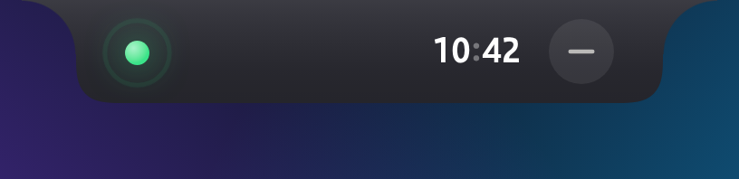
  <br>
  <b>Glanceable Collapsed Island</b>: Renders tabular numerals and unread badges while taking minimal screen space.
</p>

### Notifications and Messages

<!-- screenshot-collapsed-notification.png and screenshot-messages.png placeholders -->
| Collapsed Toast Preview | Expanded Notification Feed |
| :---: | :---: |
| 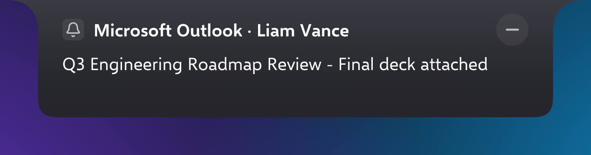<br><b>One-Line Glance</b>: Real-time toast preview with app icon and sender. | 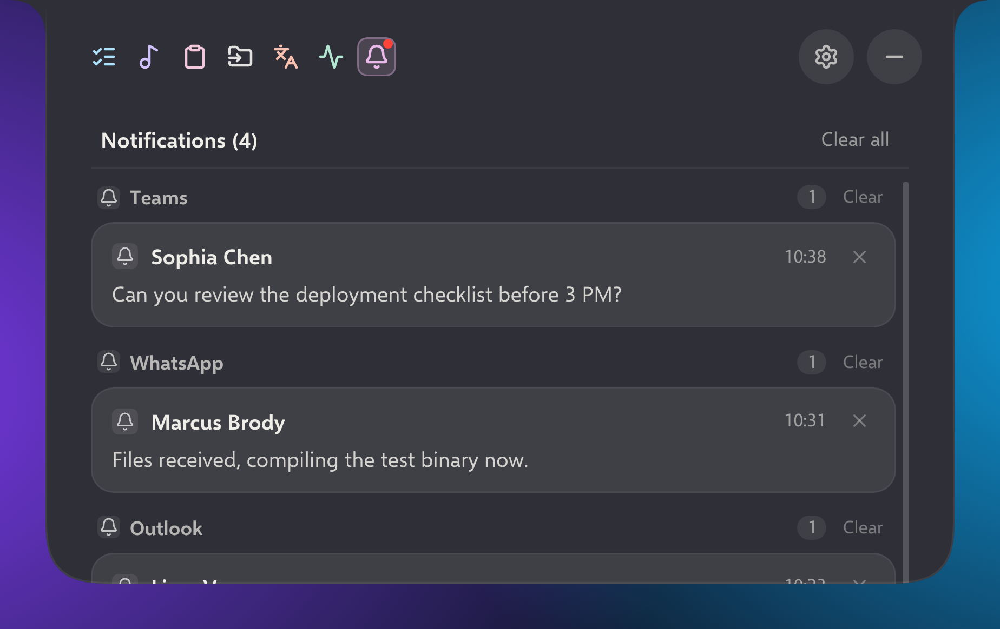<br><b>Unified Feed</b>: Grouped by application with single-click dismiss actions. |

### Media Controls and Synced Lyrics

<!-- screenshot-music.png placeholder -->
<p align="center">
  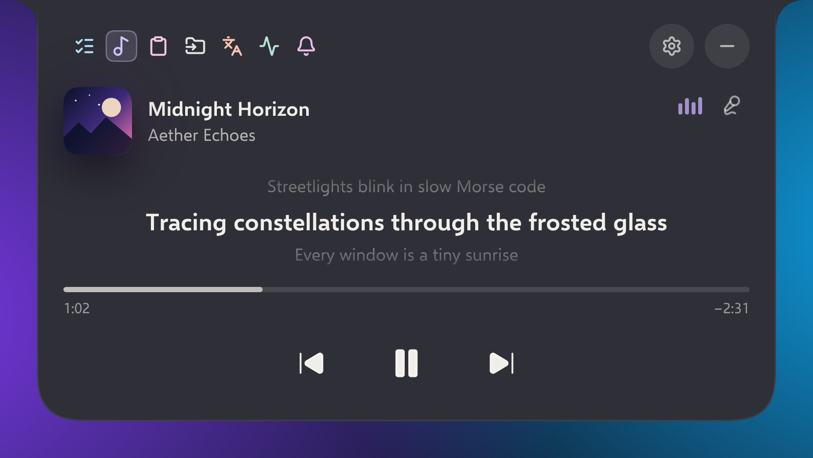
  <br>
  <b>Music and Lyrics</b>: WinRT GSMTC playback integration with synchronized line-by-line lyrics from LRCLIB.
</p>

### Tasks, Clipboard, and File Staging

<!-- screenshot-todos.png and screenshot-clipboard.png placeholders -->
| To-Dos and Focus Timer | Searchable Clipboard History |
| :---: | :---: |
| 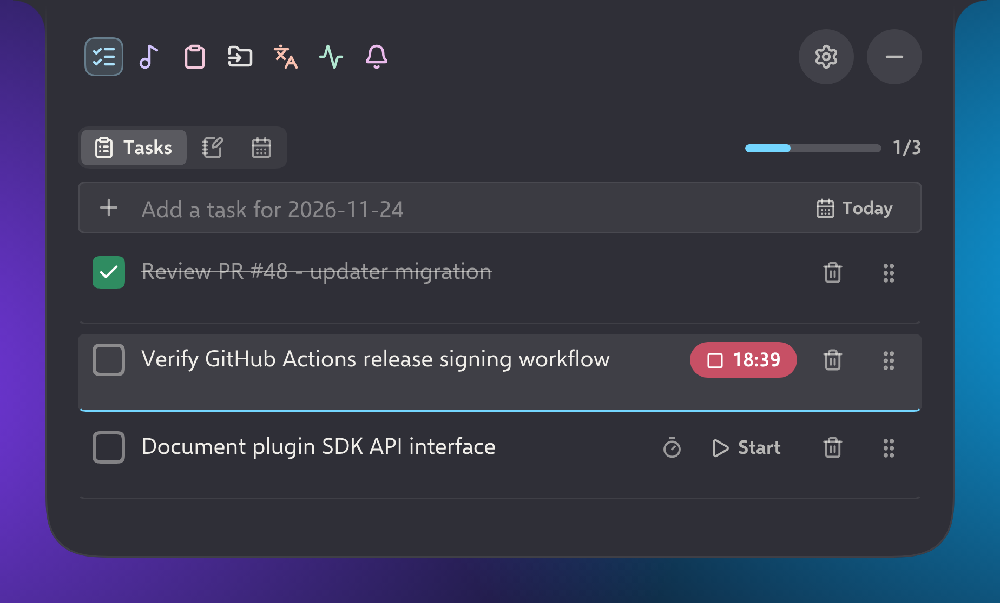<br><b>Tasks &amp; Focus</b>: Daily checklist with timers and local Markdown sync. | 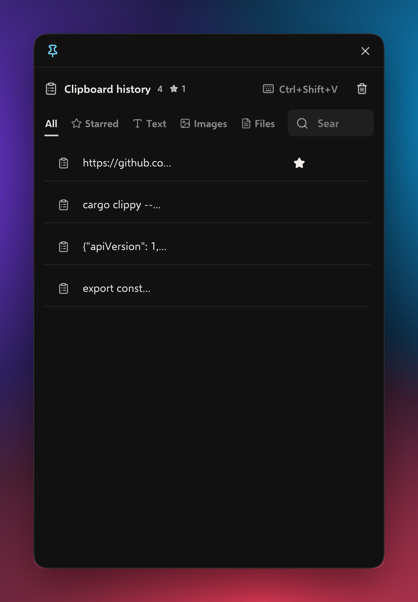<br><b>Clipboard Window</b>: Hotkey-driven (`Ctrl+Shift+W` by default) history with search, favorites, and type filters. |

<!-- screenshot-file-shelf.png and screenshot-system.png placeholders -->
| Drag-and-Drop File Shelf | Live PC Health Monitor |
| :---: | :---: |
| 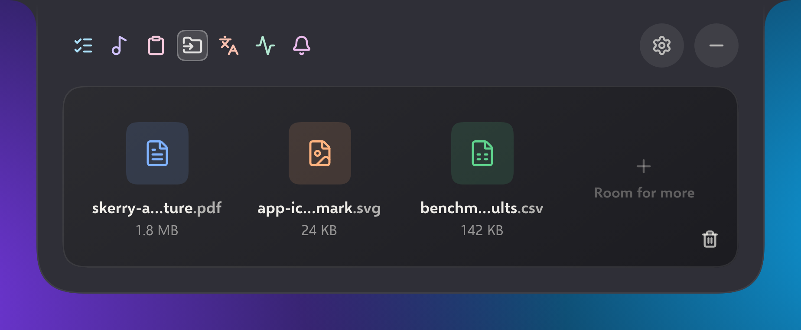<br><b>File Shelf</b>: Drop files on the island, switch windows, and drag them out. | 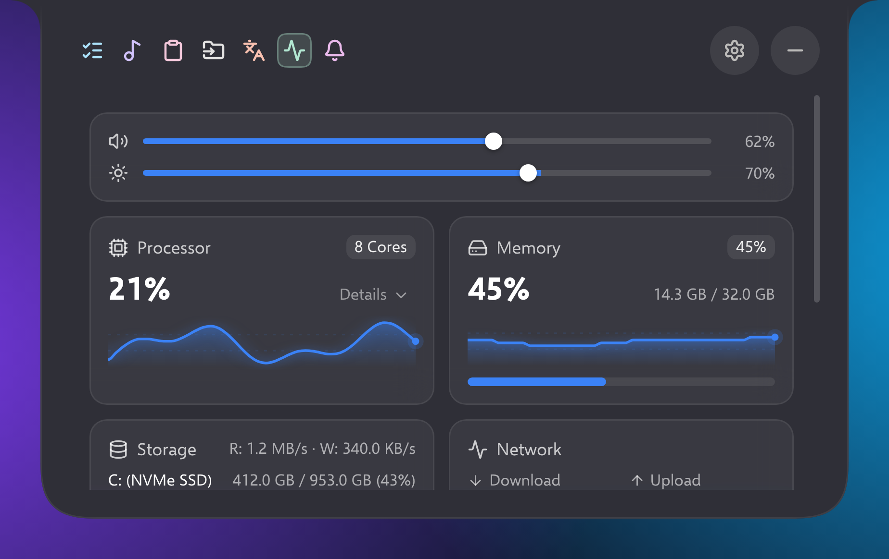<br><b>System Monitor</b>: Real-time CPU sparkline, memory, disk, and network transfer rates. |

### Settings and Theme Customization

<!-- screenshot-settings.png and screenshot-themes.png placeholders -->
| Preferences &amp; Configuration | Appearance and Material Themes |
| :---: | :---: |
| 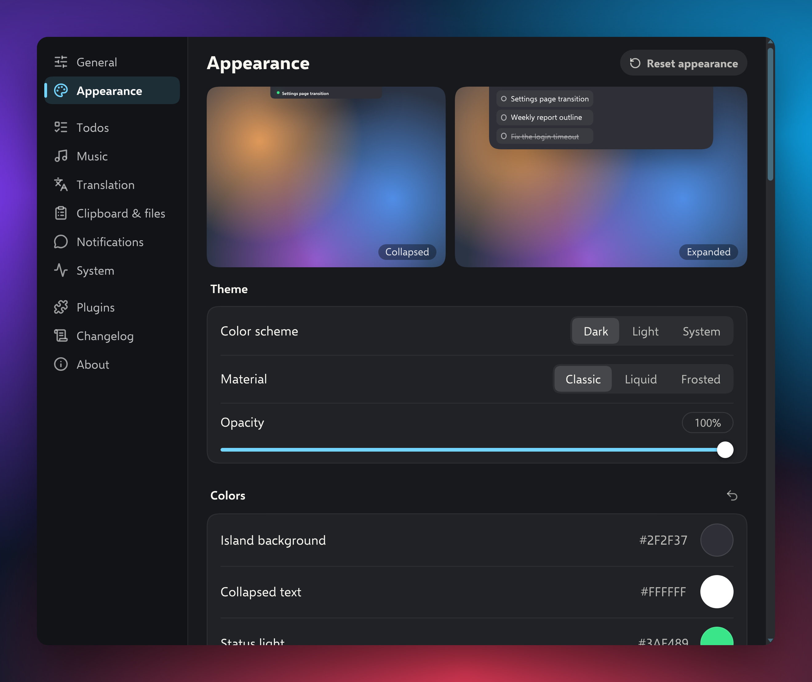<br><b>Settings Window</b>: Control toggles, behavior, shortcuts, and startup options. | 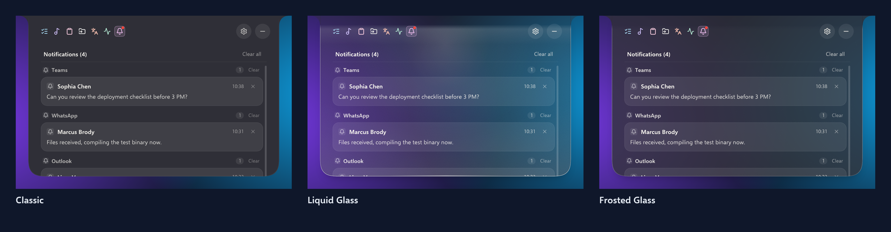<br><b>Visual Styles</b>: Classic, Liquid Glass, and Frosted Glass in dark and light modes. |

<sub>*Note: All screenshots illustrate fictional demo data in accordance with [docs/SCREENSHOTS.md](docs/SCREENSHOTS.md).*</sub>

---

## Installation

### Method 1: Installer Package (Recommended)

1. Navigate to the [Latest Release](https://github.com/ahmad-maqsood/skerry/releases/latest) page.
2. Download `skerry_<version>_x64-setup.exe` (or the `.msi` package for enterprise environments).
3. Run the installer:
   - Skerry releases are signed with cryptographic minisign signatures verified by the in-app updater.
   - Because open-source binaries without commercial certificate authority stamps may prompt Windows SmartScreen, click **More info** and then **Run anyway**.
4. Once launched, the island docks automatically at the top center of your primary monitor.

### System Requirements

- **Operating System**: Windows 10 (version 1809 or newer) or Windows 11 (64-bit).
- **WebView2**: Evergreen WebView2 Runtime (included by default in modern Windows 10 and 11).
- **Notification Access**: To display system toast notifications in the island, enable notification permissions in Windows Settings:
  - Open **Windows Settings** &rarr; **Privacy &amp; security** &rarr; **Notifications** &rarr; Ensure access is set to **On**.

---

## Building from Source

### Prerequisites

| Tool | Recommended Version | Purpose |
| --- | --- | --- |
| **Node.js** | 22 LTS or 26 | Frontend runtime and tooling |
| **pnpm** | 11.x | Fast, deterministic package manager |
| **Rust** | 1.99.1 (pinned in `rust-toolchain.toml`) | Native desktop backend and Win32 interop |
| **Visual Studio** | 2022 Build Tools (C++ workload) | Windows MSVC linker and native toolchain |
| **WebView2** | System default | Tauri window rendering host |

### Build Steps

Clone the repository and install frontend dependencies:

```powershell
git clone https://github.com/ahmad-maqsood/skerry.git
cd skerry
pnpm install
```

Run in desktop development mode (with Vite hot-reload and Rust rebuilds):

```powershell
pnpm tauri dev
```

Run the pre-commit verification suite (typecheck, lint, file size limit, unit tests):

```powershell
pnpm check
cargo test --manifest-path src-tauri/Cargo.toml
```

Compile production release packages (NSIS installer and MSI bundle):

```powershell
pnpm tauri build
```


### Source Code for Releases

Each published GitHub Release page also provides GitHub-generated source archives (**Source code (zip)** and **Source code (tar.gz)**) for the release tag. These archives let users obtain the source corresponding to that tagged release alongside the installer. See [all Skerry releases](https://github.com/ahmad-maqsood/skerry/releases).

---

## Features

- **Dynamic Island Core**
  - **Three Adaptive States**: Collapsed pill for passive monitoring, expanded dashboard for active interaction, and tucked mode (docked to screen edge as a minimal bar or hidden with hover expand).
  - **Idle Clock &amp; Weather**: Monospace tabular digits clock and local Open-Meteo weather report when no media or active alerts are pending.
  - **Screen Edge Snapping**: Draggable positioning along the top screen edge with automatic multi-monitor awareness.

- **Universal Windows Notifications**
  - **WinRT UserNotificationListener**: Captures native Windows toast notifications from messaging apps, email clients, browsers, and system services.
  - **App-Grouped Inbox**: Cards organized by originating application with timestamps, unread counts, and quick clearance options.
  - **Glanceable Collapsed Preview**: Incoming messages slide across the collapsed island for non-intrusive awareness.

- **Media Control and Live Lyrics**
  - **System Media Integration**: Controls active audio streams from Spotify, Apple Music, browsers, and media players via Windows GSMTC.
  - **Synchronized Lyrics**: Queries LRCLIB for word-by-word or line-by-line lyrics synchronized with playback.
  - **Collapsed Lyric Glance**: Active lyrical line tracks within the collapsed pill during playback.

- **Tasks, Notes, and Timers**
  - **Daily Checklist**: Quick task creation, completion toggles, and rotation.
  - **Focus Timer**: Pomodoro-style work sessions with audio cues and countdown badge in the island.
  - **Local Markdown File Sync**: Automatic bi-directional synchronization with local Markdown notes folders.

- **Clipboard Management and File Shelf**
  - **Dedicated History Window**: Press `Ctrl + Shift + W` (the default) to summon a standalone, always-on-top clipboard history manager.
  - **Rich Formats**: Stores plain text, code blocks, URLs, images, and file paths in a local history file with a thumbnail cache.
  - **Drag-and-Drop Shelf**: Temporary staging area on the island to hold files when transferring across full-screen apps.

- **Live PC Health Monitor**
  - **Resource Usage**: Glanceable CPU load with a 60-second sparkline, RAM usage, and active per-drive storage.
  - **Network &amp; Wi-Fi**: Current upload/download throughput and active network connection details.

- **Quick Translation**
  - **Instant Hotkey**: Press `Ctrl + Shift + F` to open a lightweight translation card.
  - **Flexible Providers**: Keyless Google Translate and MyMemory, plus OpenAI and custom OpenAI-compatible API endpoints (keys are kept in Windows Credential Manager).

- **Privacy, Backup and Extensibility**
  - **Mic and Camera Indicator**: Reads the Windows privacy consent store, locally and read-only.
  - **Backup and Transfer**: Export and import your settings (clipboard history only if you opt in) from Settings -> General.
  - **Plugin Host**: A stdio plugin API (Plugin API v1) for quota, session and notification plugins. It ships switched off; see [docs/plugins/README.md](docs/plugins/README.md).

---

## Architecture

Skerry is built using Tauri 2, combining a React 19 frontend with a modular Rust desktop core interacting directly with Windows Win32 and WinRT APIs.

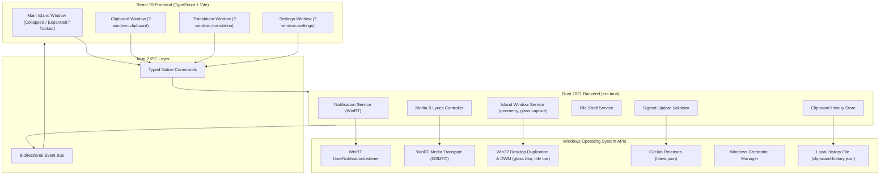

### Technology Stack

| Layer | Technologies | Role |
| --- | --- | --- |
| **Frontend Framework** | React 19, TypeScript (Strict), Vite 7 | Fast reactive UI, zero bundle bloat |
| **Desktop Shell** | Tauri 2 (`@tauri-apps/api`, updater, opener, single-instance) | Native window management and secure IPC |
| **Native Backend** | Rust 2021, `windows` crate (Win32 &amp; WinRT) | System integrations, low memory footprint |
| **Local Storage** | JSON history file plus image cache | Clipboard history kept on this PC |
| **UI Components** | Lucide React | Consistent icon set |

### Project Directory Structure

```text
.
├── src/                      # React 19 frontend codebase (rules in src/AGENTS.md)
│   ├── components/           # Reusable UI widgets and settings rows
│   ├── features/             # Domain modules (todos, media, clipboard, file-shelf, messages, system-monitor, plugins, ...)
│   ├── windows/              # One directory per window: island, settings, clipboard, translation
│   ├── i18n/                 # UI strings, organised by section
│   └── styles/               # Design tokens, base styles, fonts
├── src-tauri/                # Rust desktop backend (rules in src-tauri/AGENTS.md)
│   ├── src/                  # Native commands, background services, and system APIs
│   │   ├── island/           # Main window geometry, tucking, glass capture, click-through
│   │   ├── system/           # Startup, updater, todo Markdown sync, fullscreen detection
│   │   ├── system_notifications/ # Generic WinRT toast notification listener
│   │   ├── plugin_host/      # Plugin API v1 host (manifest, protocol, packages, processes)
│   │   └── win32/            # The only place with unsafe Win32 / COM code
│   ├── capabilities/         # Tauri security permission definitions
│   └── tauri.conf.json       # App configuration, window descriptors, and updater endpoint
├── plugins/                  # Example plugin crates and the plugin SDK (separate Cargo workspace)
├── scripts/                  # Release automation, size checks, screenshots, and regression runner
├── tests/                    # Unit tests, script tests, browser regression pages, screenshot scenes
├── docs/                     # Architecture, design notes, updater/release guide, plugin guide, screenshot shot list
├── .github/workflows/        # CI and Release workflows
├── release-features.json     # Release feature flags shared by the frontend and Rust
├── AGENTS.md / DESIGN.md     # Contributor and AI-agent rules; confirmed UI design conventions
├── SECURITY.md               # Vulnerability reporting process
├── NOTICE.md                 # Open source attribution and credits
└── LICENSE                   # GNU General Public License v3.0
```

---

## CI and Releases

Skerry's CI/CD runs entirely on GitHub Actions. CI jobs run side by side, so a run takes as long as its slowest job:

- **Continuous Integration (`.github/workflows/ci.yml`)**, on every push to `main`, on every pull request, and on a manual run from any branch (changes that only touch Markdown, `docs/` or issue templates skip it):
  - **Frontend checks** (`ubuntu-latest`): `pnpm check` (type check, test type check, ESLint, file size limits, Node unit tests) and a production Vite build.
  - **Browser pages** (`windows-latest`, three shards): the headless Chrome regression pages, which need Windows fonts, split across three runners with `scripts/run-regression.mjs --shard=i/3`.
  - **Clippy** and **Rust tests** (`windows-latest`, one job each): `cargo clippy --all-targets -- -D warnings` for the app and the plugin workspace, and `cargo test --lib` for the app plus `cargo test --workspace` for the plugins, each with its own Rust cache.
  - **Gate Check**: a lightweight `CI passed` status check that needs all of the above, for branch protection.

- **Releases (`.github/workflows/release.yml`)**, started by hand with **Run workflow**:
  - **Publish unticked**: a quick trial that builds and signs only the NSIS installer and attaches it to the run.
  - **Publish ticked**: runs `pnpm check`, builds and signs the NSIS and MSI installers, generates `latest.json` and publishes the GitHub Release. Clippy and the Rust tests are not repeated; CI already ran them.
  - Signing needs the repository secrets `TAURI_SIGNING_PRIVATE_KEY`, `TAURI_SIGNING_PRIVATE_KEY_PASSWORD` and `TAURI_UPDATER_PUBKEY`; see [docs/updater.md](docs/updater.md).
  - The in-app updater queries `https://github.com/ahmad-maqsood/skerry/releases/latest/download/latest.json` and performs silent background downloads with idle auto-install.

---

## Privacy and Permissions

| Resource / Capability | Usage | Storage Location |
| --- | --- | --- |
| **Notification Listener** | Captures incoming toast alerts to display on the island. | In-memory only; cleared upon quitting the application. |
| **Clipboard History** | Stores copied text, images, and file paths when enabled. | The app data folder (`clipboard-history.json` and a `clipboard-images` folder). Stored unencrypted. |
| **API Keys &amp; Secrets** | Optional custom translation API keys and credentials. | Windows Credential Manager (OS-level secure vault). |
| **Network Requests** | Limited strictly to: in-app update checks (`github.com`), weather forecast queries (`open-meteo.com`), lyrics queries (`lrclib.net`), user-initiated translation, and the plugin catalog and package downloads (`github.com`) when the plugin host is switched on. | No external analytics or tracking servers are ever contacted. |

### Known Limitations

- **VS Code In-Editor Notifications**: Notifications rendered internally inside VS Code editors do not generate Windows toast notifications and therefore cannot be captured by the OS notification listener.
- **Full-Screen Exclusive Games**: Skerry automatically respects full-screen exclusive applications and suppresses idle installations during active gaming sessions.

---

## Contributing

- Contributor and AI-agent rules: [AGENTS.md](AGENTS.md) (with [src/AGENTS.md](src/AGENTS.md) and [src-tauri/AGENTS.md](src-tauri/AGENTS.md)); UI conventions: [DESIGN.md](DESIGN.md).
- Run `pnpm check` (and `cargo test --manifest-path src-tauri/Cargo.toml` for Rust changes) before opening a pull request.
- Plugin authors: see the [Plugin Development Guide](docs/plugins/README.md).

---

## Security

For instructions on reporting security vulnerabilities, please refer to [SECURITY.md](SECURITY.md).

---

## Licence and Credits

Skerry's main application is a modified derivative of [Fly Island](https://github.com/flyl1u/fly-island) and is distributed under [GNU GPL-3.0-only](LICENSE). The project-origin and modification history are recorded in [NOTICE.md](NOTICE.md).

The optional plugin workspace crates under `plugins/` declare the MIT License; see [plugins/LICENSE-MIT](plugins/LICENSE-MIT). Third-party dependency license details and the current scope of the license inventory are explained in [NOTICE.md](NOTICE.md).

The full GPL license text is configured for inclusion in the Windows installer bundles.
